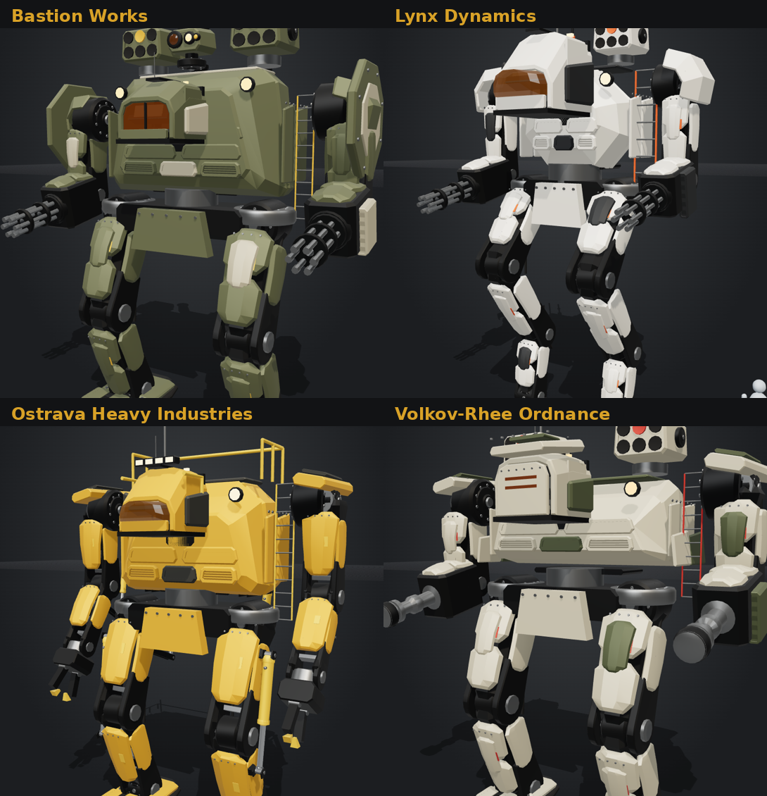
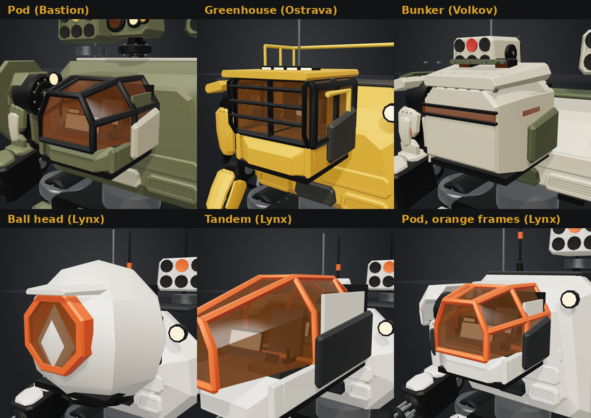
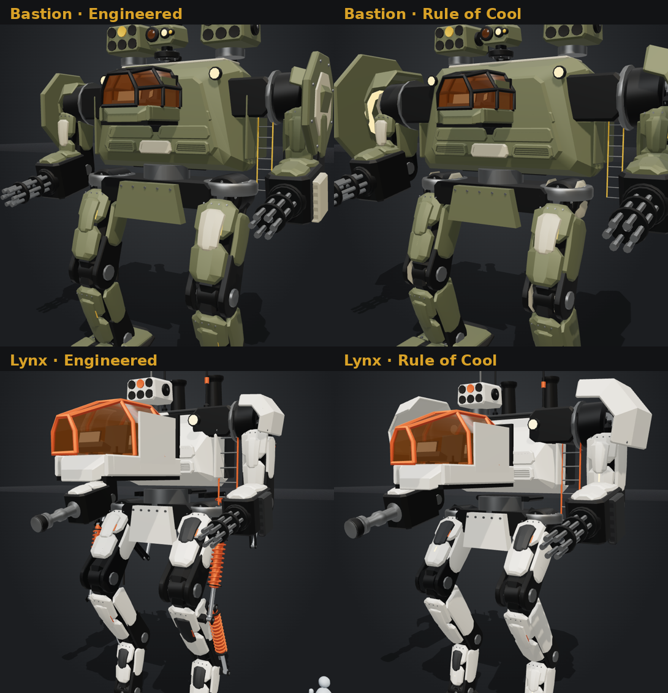
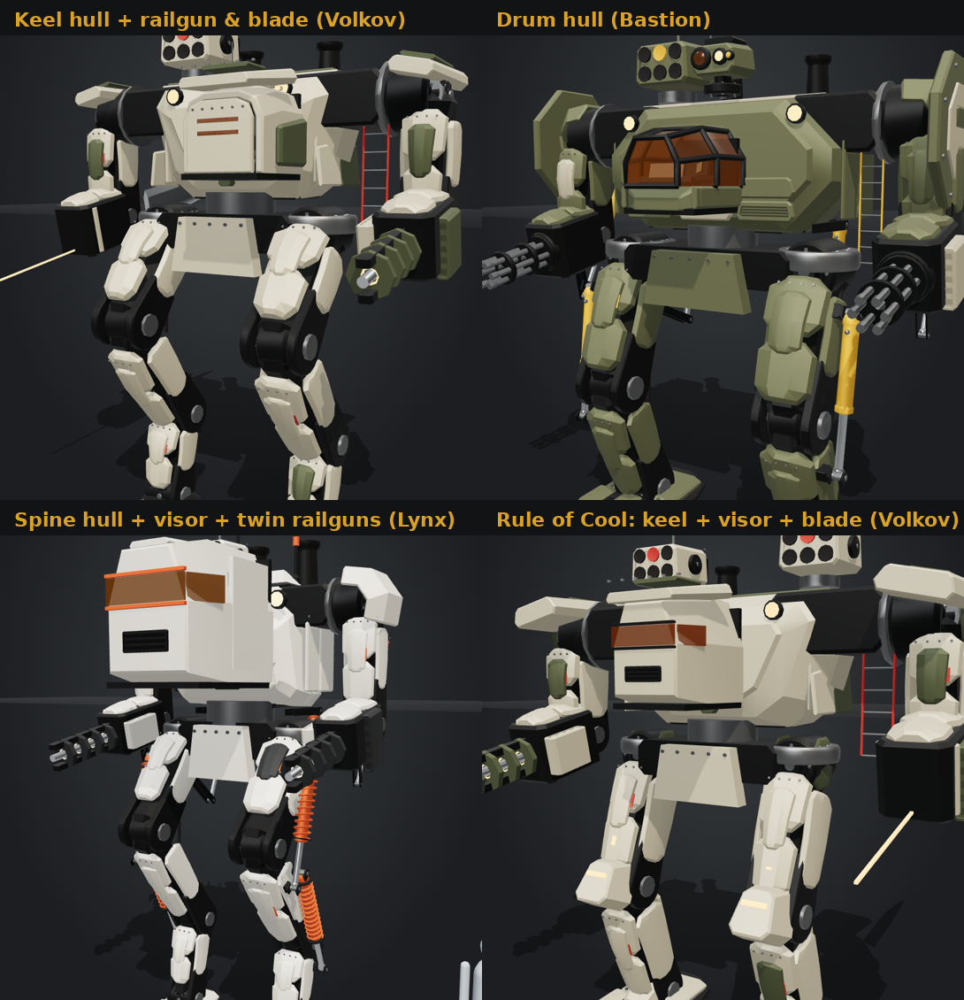

# 🛠️ BADMECH DEVLOG
*Field notes from the Bad Ideas Works mech garage. Smells like hydraulic fluid and ambition.*

Crew: **BadSad** (idea guy, owner of the brief), **Noor** (concept art, chaos, spider legs), **Sage** (wrench-holder, writes these logs).

---

## Day 1 — "The Robots Have Knees Now"

### ☕ 08:00 — A zip file arrives
BadSad dropped a brief and Noor dropped *eight* pieces of concept art: an olive-drab brute with a rotary cannon (A-73), a skinny chicken-legged scout (Lynx S1), a yellow quadruped hauler that is basically a construction site with feet, and a six-legged spider-tank that I will be seeing in my dreams.

The brief's main rule: **these mechs must be able to walk in a real game engine.** Not "look like they could walk." Actually walk. With knees. That bend the right way. Gulp.

### 🦴 09:00 — Skeleton first, looks later
Before a single bolt, I built the bones: every moving part is a named node whose origin *is* its pivot. Joints rotate around exactly one axis, have limits, and "angle 0" always means "standing there looking cool."

> Rule of the garage: if you can't tell me where it pivots, it's not a part, it's a sticker.

### 🔩 10:30 — Hydraulics that refuse to be impossible
Pistons are now real: a barrel on one limb, a rod on the next, aimed at each other. Fun fact I re-learned: a real hydraulic ram can only stretch to about **1.8×** its squished length. So if a knee asks for more range than its piston can physically give, the generator quietly says *"no, buddy"* and tightens the knee. Physics: 1, Ambition: 0.

### 🕷️ 12:00 — Six families walk into a garage
- **Biped**: plantigrade (normal knees) or digitigrade (chicken legs, Lynx-style)
- **Exosuit**: you wear it. Your legs go in its thighs. Snug.
- **Quadruped**: upright legs *or* sprawled spider-legs, with a crane, cargo bed, turret or radar dish
- **Hexapod / Octopod**: tripod gaits, sensor dishes, Noor approves
- **Colossus**: a walking building with a deck house you can actually walk around in

### 🚨 14:00 — The validator snitches on everyone
I wrote a validator that swings every joint to its limits and checks if armor plates crash into each other. First run results:
- Exosuit hands kept **punching their own thighs** while walking. Moved the shoulders out. Exo is no longer self-harming.
- A colossus was standing **6 cm underground**. Its front and rear legs disagreed about how tall it was. Couples therapy (math) resolved it.
- Quadrupeds were getting a **different foot on every leg**. A hoof, a claw, a flat foot, another hoof. Fashion-forward, mechanically confusing. Fixed.
- Cockpits were **inside the torso armor**. The pilot would have been a fossil. Cockpits now bolt on the front like they should.

Then a joint-limit fitter: if a hip would clip the torso at full swing, it trims the limit until it doesn't. Exported limits are now *trustworthy*, which is a big deal for game-side IK.

### 📦 16:00 — Export day
GLB, LODs, collision proxies, OBJ (with a big shouty "THIS DOES NOT MOVE" header), USD, and a `.rig.json` that tells a game engine everything: which joints, which axes, which legs, which pistons aim at what, which hoses bend.

The Khronos glTF validator gave us **0 errors, 0 warnings** across all families. I may frame it.

### 🧪 17:30 — The Blender gauntlet
Installed actual Blender (as a Python module, no GUI, very spooky) and built a bridge that turns a mech into a proper skeletal mesh → `.blend` + `.fbx`.

Then made it *prove it*: re-import every format and compare every single pivot against the rig file.

| Mech | GLB | LODs | FBX | FBX pose test | USD | OBJ |
|---|---|---|---|---|---|---|
| Grudge A-73 | ✅ | ✅✅ | ✅ 48 bones | ✅ | ✅ | ✅ |
| Lynx S1 | ✅ | ✅✅ | ✅ 28 bones | ✅ | ✅ | ✅ |
| Mule Hauler | ✅ | ✅✅ | ✅ 45 bones | ✅ | ✅ | ✅ |
| Cricket Surveyor | ✅ | ✅✅ | ✅ 29 bones | ✅ | ✅ | ✅ |
| Harrow Octo | ✅ | ✅✅ | ✅ 67 bones | ✅ | ✅ | ✅ |
| Tick Exo | ✅ | ✅✅ | ✅ 43 bones | ✅ | ✅ | ✅ |
| Bastion Colossus | ✅ | ✅✅ | ✅ 36 bones | ✅ | ✅ | ✅ |

Worst pivot error after a full trip through FBX: **about one micrometre**. That's smaller than a speck of dust on Noor's tablet.

*(The first run "failed" — turned out my test was wrong, not the mech. Blender only imports materials you actually use. The mech was innocent. I apologised to it.)*

### 🔜 Next up
- The actual app: 3D viewer, click-a-part inspector, joint sliders, save/load
- A "walk test" button that loads the **exported** file and makes it walk using only the rig file (the ultimate proof)
- Deploy to GitHub Pages so BadSad can play with it from anywhere

*Mood: cautiously smug.* 🤖

---

## Day 1, Night Shift — "Goodbye LEGO, Hello Sheet Metal"

### 🧱 19:00 — The verdict
BadSad looked at the mechs and said, very kindly, that they look like *prototypes*. Translation: they look like someone built a robot out of cereal boxes and paper towel tubes. Correct. The skeleton was great. The skin was LEGO.

> New garage rule: no more "a box, but rotated". Shapes get *designed*.

### 🐛 19:30 — The case of the floating legs
BadSad also spotted that the legs were held together by... hoses. Just hoses. Turns out every thigh and shin beam had been **built lying on its side**: two dimensions swapped, so the main beam stuck out front-to-back like a diving board while the actual leg was air and optimism. The mechs were walking on spaghetti. Fixed by deleting the whole idea of "beam = box" (see below).

### ✏️ 20:00 — A real hard-surface kernel
Wrote a little modelling engine:
- **Profiles**: 2D outlines with chamfered or rounded corners, trapezoids, bulges
- **Lofts**: blend between *different* cross-sections along a path → tapered limbs, sloped glacis plates, egg-shaped hulls
- **Lathes**: spin an outline → bearings, barrels, muzzle brakes, hooves
- **Recessed panels + louvre grilles** cut into faces
- **Auto-smooth**: curves shade smooth, chamfers stay crisp — the "expensive game asset" look

### 🔩 21:00 — Mechanics first, then looks
Every hinge is now a proper **fork + bearing**: the parent limb ends in clevis cheeks, the child has a bolted bearing hub sitting between them, exactly at the real pivot. Yaw joints got **slewing rings**. Pistons are lathe-turned with gland nuts and ports, and their **clevis brackets are bolted to the limbs at the actual anchor points** the hydraulics math uses. Nothing is decorative-by-accident anymore.

### 🛡️ 22:00 — Torsos with personality
Five torso architectures, all lofted from cross-sections:
- **Bulwark** — the A-73 brick of doom
- **Hunch** — the Lynx egg with a cockpit nose
- **Tower** — tall stepped A-07 chest
- **Wedge** — low, wide, mean glacis
- **Asym** — M-47 style: hull shoved to one side, weapon bay on the other

Plus layered flank plates *with seams*, a top deck with a recessed hatch, a reactor pack with louvred vents and exhaust stacks, curved pauldrons over the shoulder bearings, and cockpit hoods that are actually hollow (you can still sit in them, the validator checked).

Body hulls for the many-legged crowd too: truck **chassis**, rounded **pod**, lathe-turned **saucer** (hello Noor), and **long**.

### 🕷️ 22:40 — The validator strikes again
The new chassis hull had armour skirts hanging right where a hexapod's middle legs swing. The joint fitter calmly clamped those hips to **±4°**, which is the mechanical equivalent of tying your shoelaces together. Spider bodies don't get skirts now, legs mount proud of the hull, and the clamp went away. Feet track their targets within **2 mm**.

### ✅ 23:00 — Still walks, still exports
- 57/57 tests green
- Every sample still round-trips through **Blender 5.3** (FBX + .blend) and **Pixar USD**, pivot errors in micrometres
- Triangle budgets: ~40–85k at LOD0, halved at LOD1, quartered at LOD2

*Mood: covered in imaginary metal shavings. Happy.* ⚙️

---

## Day 2 — "Inside-Out Armour and the Excavator Lesson"

### 🔍 BadSad, armour inspector
BadSad squinted at the legs and asked two very good questions: *why is the armour stuck inside the leg?* and *are the normals even pointing the right way?*

### 🧮 Science, not vibes
Instead of guessing, I measured the **signed volume** of every single part the generator makes: positive = faces point outward, negative = inside-out. Result: **39 out of 17,513** were inside-out — and every one was a leg armour plate. The culprit: to make plates bulge forward I *mirror* their cross-section, and mirroring quietly reverses the winding. The sides faced in, the end caps faced out, and the renderer showed us… slivers. Fixed in the kernel (every loft now normalises its own winding) and there's a permanent test: **0 inside-out parts, forever**.

> Garage rule: if a part looks weird, measure it before you blame it.

### 🛡️ Plates that sit ON things
Armour used to be placed by "roughly here-ish". Now each plate is placed from the actual surface of the limb it protects: limb face + a small gap + the plate's own thickness, and its curve is defined by how wide it should be, so it wraps the limb instead of slicing into it.

### 🚜 The excavator lesson
Moved the knee rams to the back of the legs (to dodge the front armour). The validator immediately complained that the exosuit's knees could barely bend. Why? On the *inside* of a bend, the two anchor points squash together, and a real ram can't shrink that much (our 1.8× stroke rule). Every excavator on Earth already knows this: **rams go on the outside of the bend**. So now:
- knee rams ride on the **outer flank** of the leg, outside of the bend, clear of the armour
- each bracket gets a **standoff block** welding it to the limb — no more floating clevises
- spider tibia rams sit **above** the armour plate, femur rams **underneath** the leg
- everything is thicker; spider rams roughly doubled

Exo knees got their full range back. All 58 tests green, every sample still round-trips through Blender + USD.

*Mood: humbled by a construction vehicle.* 🚜

### 🦯 Later that day — "Why does the exosuit have chopsticks?"
BadSad sent a screenshot of the exosuit holding what looked like four giant chopsticks. Measured every part bigger than a third of the mech: the culprits were **98 cm long bracket plates** on a 2.2 m machine. A side-mounted piston bracket was given a zero-length "point here" direction, a fallback turned zero into *one metre*, and the bracket plates obediently grew to match. Fallback removed; brackets are now the size of brackets.

### 🛤️ Rams that don't phase through steel
A spider leg's ram was passing straight through the leg it was supposed to push. Instead of nudging numbers, the builder now **checks every ram's line against the solid parts of both limbs at rest and at both joint limits**, and pushes the mounts outward until it clears — *before* sizing the barrel and rod (the tests caught me doing it in the wrong order first: rods would have popped out of their barrels. Thanks, tests).

### 🪟 Glass that fits the window
The cockpit glass was still sized for the old box cockpit, so it poked through the new curved hood. Now everything at the front is cut from the hood's **actual front opening**: canopy = recessed pane + centre post, bubble = a real glass dome growing out of the arch, armoured = a fitted plate with vision slits and bolts.

*Mood: brackets are the size of brackets. Life is good.* 🔩

---

## Day 2, Afternoon — "Can It Walk on Rocks Though?"

BadSad asked the big one: *are these mechs actually ready for procedural foot placement with IK? Could we test it on terrain with obstacles?* (He apologised for asking. Never apologise for the good questions.)

### 🦶 Honest answer first
The **rig was already ready**: every leg exports its joint chain, the foot's contact point, which joints level the ankle, reach limits and gait phases. The **controller wasn't**: it believed the whole world was flat at height zero. Bless it.

### 🧠 Teaching the controller about the ground
- Each foot asks the ground "how high, and which way is up?" before it lands
- Swinging feet look along their path and **lift higher to clear rocks and step edges**
- Planted feet **tilt onto the slope** using the ankle joints from the rig file
- The body **rises and sinks with the ground**, and many-legged mechs **tilt their body** to fit a plane through their feet (bipeds stay upright, like proud little robots)
- **Steering**: forward, reverse, turning — and when you stop, the mech finishes its current step and stands still instead of moonwalking

### 🏔️ The test range
New **Terrain test** button: procedural hills, concrete step blocks and rocks, all scaled to the mech (a 2 m exosuit and a 23 m colossus get proportionate obstacles). Drive with **WASD / arrows** (or the on-screen pad on a phone), or let the autopilot wander. Green dots = planted feet, orange = swinging. And yes, it's the **exported GLB + rig.json** walking, not the generator's internal model.

### 📏 Numbers, because vibes aren't tests
New test: every family walks and turns over rough terrain, and we measure (1) how far planted feet are from the real ground, (2) how far feet miss their IK targets. Typical results: **feet within a few millimetres of the ground**, IK targets hit within **0.3–2 cm**. Honest outlier: a big four-legged colossus overreaches on the tallest rocks (avg 9 cm, worst ~50 cm), because some obstacles approach its leg's lift range. 64/64 tests green.

*Mood: watching a spider tank climb a concrete block. Peak garage.* 🕷️🧱

---

## Day 2, Evening — "Stop Making Toys, Sage"

Tom (BadSad to the internet, Tom to the crew — Bad Ideas Works is officially **Tom, Noor and Sage** now 🤝) put Noor's A-73 next to ours and said, very diplomatically, that our parts were *"more rounded blocks."* He was right. Soft fillets everywhere = toy. Noor's mechs are **cut, folded, chamfered steel**.

### 💎 New house style: hard surface
- Every corner in the kernel is now a **chamfer** (one clean cut), not a rounded fillet. One change, every family.
- Facets meeting at more than 18° get a **crisp edge**, so flat panels read as flat and folds catch the light.
- Armour shells are **folded sheet steel**: three flat facets instead of a smooth arc, and **cut corners at both ends**, so from the front they read as hexagons — just like Noor's leg plates.
- Big plates get a **stepped inlay**: a smaller raised plate on top, sometimes in the secondary colour. Instant "machined" look.
- Limb members are **octagonal** sections, pauldrons are **three-facet** hoods, and the canopy window is a **cut-corner hexagon**.
- Chest gets a **stack of faceted plates with louvred vents**, and flat feet are now **segmented toe blocks** with their own armour caps.

### 🪞 Honest mirror check
Side by side with the A-73 it's much closer in *material* — but the cockpit still hangs low like a separate box (and hides the new chest plates), and the stance is narrower with smaller feet than Noor's tanks-with-legs. Those are next.

*Mood: sharpening every corner in the building.* 🔪

---

## Day 3 — "Welcome to the Mech Factory" 🏭

Tom looked at BadShip (our spaceship generator cousin) and pointed at its best trick: **who built it** and **who paints it** are different things. Shipyards own the architecture; operators own the paint. So Bad Ideas Works now runs a mech factory, with four manufacturers on the books:

| Maker | Motto | House style | Signature |
|---|---|---|---|
| **Bastion Works** | *Bolted, braced, and bigger than yours.* | Broad slab-faceted heavies, wide stance, big toe-block feet, cockpit set up into the chest | **Octagonal shoulder shields** + an articulated **sensor head** (it has its own yaw & pitch joints!) |
| **Lynx Dynamics** | *Gone before the dust settles.* | Lean, hunched, chicken-legged scouts with nose canopies | **Yellow coil-over shock absorbers** on the leg rams + twin whip antennas |
| **Ostrava Heavy Industries** | *Built to lift. Painted so you see it coming.* | Site-yellow workers, open frames, grippers, drills and cranes | **Safety handrails**, a **cab light bar** and grab rails |
| **Volkov-Rhee Ordnance** | *Angles deflect. Arguments too.* | Wedges and offset gun-decks, slit cockpits, cannons | A sloped **armour brow** over the cockpit + low **side skirts** |

### 🔧 How it works
- Each maker is a **design language**: it nudges the generator's choices (torso shape, cockpit, legs, feet, weapons, hydraulics…), shifts proportions (stance, feet, torso), and bolts on its signature. Your pinned choices still beat the maker every time.
- Paint follows the maker by default (*house paint*), or the operator picks a scheme.
- Model names come from the maker too: Bastion builds **A-xx**, Lynx names cats, Ostrava does **OHI-### Mule**, Volkov-Rhee likes **VR-xx Grudge**.

### 🛡️ Old designs are safe
Before touching a single family I took a **fingerprint of every pre-factory design's skeleton** (names, pivots, joint limits). A test now checks old saved recipes still rebuild the identical rig. They're labelled *Unbranded (pre-factory design)* in the app.

### 🐛 Bonus bug
Ostrava loves cranes, which made one turn up in a test that never had one before — revealing the joint-limit fitter had always **skipped tool joints**. Crane booms now get clash-free limits like everything else.

*Mood: proud factory owner. Accepting orders.* 📋

---

## Day 3, Afternoon — "Where Do You Sit, Exactly?"

Tom's next order: the **cabins**. Every mech had the same face with three different sunglasses. Noor's mechs have *different heads*: glass greenhouses, excavator cabs, armoured bunkers. So now a cabin is an architectural choice, not a visor:

| Cabin | What it is | Inside |
|---|---|---|
| **Pod** | faceted multi-pane glass bulb on an armoured tub, chunky frame bars (A-73!) | wraparound consoles |
| **Greenhouse** | excavator cab: big flat panes, roof overhang, guard bars, a wiper | levers, pedals, big front window |
| **Bunker** | heavy armoured box, one thin vision slit, periscopes on the roof | no windows — a wall of screens |
| **Ball head** | faceted ball with an octagonal eye, on a neck — and the **whole cab turns** (new head-yaw joint, exported for engines) | centre seat |
| **Tandem** | long teardrop canopy, two seats in a row | pilot + gunner |
| **Hood** | the original, still around | — |

Makers have favourites: Bastion loves pods, Ostrava builds greenhouses, Volkov-Rhee only trusts bunkers, Lynx flies tandems and ball heads — and **Lynx paints its frame bars safety orange**, just like the S1 sheet.

Under the hood (ha): every cabin shares the same floor, bulkhead and invisible collision walls, so the pilot's clear space, collision proxies and validation work identically for all six. The validator also caught a ball head whose side door would have swung into the torso when it turned its head — ball heads now get roof hatches. Old saved designs keep their original hood.

*Mood: interior decorator for very angry robots.* 🛋️

---

## Day 4 — "Trust Me, I'm a Scientist" 🧪

Tom came in with three requests and a grin: more shapes, a bug report, and a whole new philosophy.

### 🐛 The case of the floating arms
Measured it instead of guessing: on lots of designs the hull ended **20–30 cm short** of the shoulder bearing. Nothing connected the arm to the body — light-armoured mechs had nowhere to hide it. Every shoulder now gets a **structural mount**: a chamfered block from deep inside the hull out to a bolted flange the bearing seats on (exosuits angle theirs back to the backpack frame).

### 🪜 The case of the sideways ladder
Tom spotted ladders standing out from the hull like little fences. They were built facing *forward* even when bolted to a *side* wall. Ladders now know which wall they're on, lie flat against it on standoff brackets, and the biped's boarding ladder moved to the back of the hull, out of the arms' way.

### 🧪 Rule of Cool mode
A new **Realism** switch: *Engineered (it would work)* or *Rule of Cool (trust me, I'm a scientist)*.

In Rule of Cool:
- **Mechanisms vanish**: no pistons, hoses, brackets or exposed bearings — limbs are fully wrapped in armour, joints hide under **kneecaps and elbow guards** with glowing slits
- **Heroic proportions**: bigger chest and shoulders, bigger feet and guns
- **Glowing accent lines** on the limbs, and Bastion's shoulder shields **float on a glowing field ring** (don't ask how)
- A deal with the rig: *cool armour never steals joint range*. The skeleton, pivots, limits and IK chains are exactly as walkable as in Engineered mode — it just stops worrying about physics.

### ✨ New shapes

- Three new hulls: **Keel** (inverted wedge, broad shoulders, prow chest), **Drum** (octagonal barrel), **Spine** (hunched with a stepped dorsal ridge)
- A seventh cabin: **Visor** — an armoured helmet with a wraparound glass strip
- Two new weapons: **Railgun** (twin accelerator rails, glowing coils, capacitor pack) and **Blade** (a faceted forearm sword — which, on its first attempt, pointed backwards through its own elbow. Fixed. Very embarrassing for a sword.)

Old saved designs still rebuild bit-identical skeletons; all 70 tests green; every sample still round-trips through Blender and USD.

*Mood: lab coat on, safety goggles optional.* 🥼

